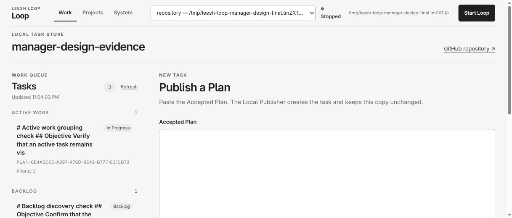
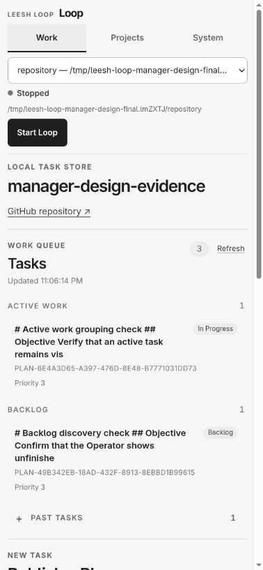
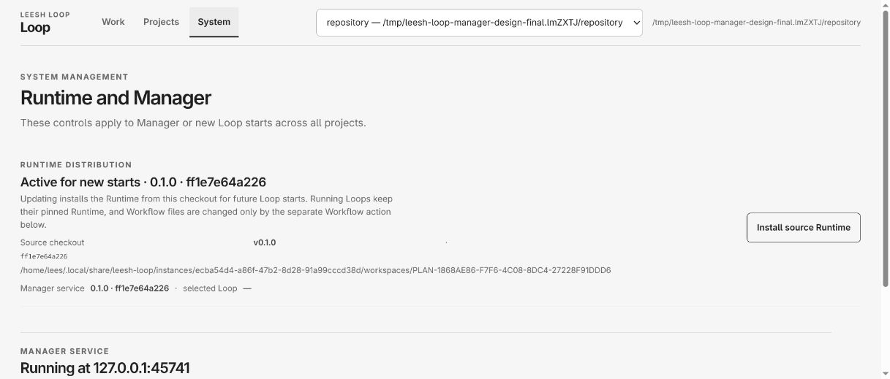
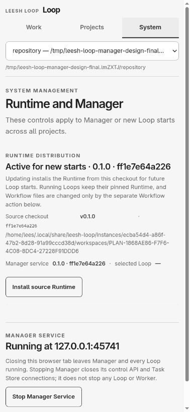

# Manager and CLI redesign evidence

## Direct Work and System UI evidence at source HEAD `bc32a53b5f26a964c2d5e4c32b2687964417db45`

The screenshots below were captured from the actual Chrome tab rendering the isolated Manager at `http://127.0.0.1:45741/`. The Manager Runtime was `ff1e7e64a2269e0a01c0299e33992fb92abc3f9859d1b012de0ac0170398b41c`; its UI code came from `bc32a53b5f26a964c2d5e4c32b2687964417db45`. At capture time PR #122 was at `241bf9bd8a25d7d70d7b8a1c39f9be61741263d9`. Comparing `operator/ui/` and `operator/app/` at that PR HEAD with `bc32a53` shows no source differences, so the rendered application code is identical.

Desktop screenshots are 1217×519 browser pixels. Narrow screenshots use a 390×844 CSS-pixel viewport at device pixel ratio 1.25; the saved page images are 378×817 pixels. The document client width and scroll width were both 378 CSS pixels, so the inspected pages had no horizontal overflow. The browser displayed the isolated `repository` project, with its Loop already `Stopped`, and three test Tasks: one `In Progress`, one `Backlog`, and one `Done`. The Manager Service was running. This continuation did not start, stop, or restart any Manager or Loop. The user-profile Manager at `127.0.0.1:4320` and its Loop were left untouched.

These are direct Chrome screenshots, not reconstructed images. The CUA screenshot bytes were written by `receive-browser-capture.mjs`, a one-shot receiver bound to `127.0.0.1` that accepts a token-authenticated PNG or JPEG into this evidence directory. No API or lifecycle action was used to produce the screenshots. The Work and System pages were switched through their visible navigation controls and their rendered accessibility trees were read before capture.

### Work at desktop width

The unfinished `Backlog` group and Task card are directly visible in the main queue.

### Work at 390px CSS width

Active Work, Backlog, the `Past Tasks` disclosure, and the next Task action remain visible in the narrow layout.

### System at desktop width

The shared Runtime and Manager Service responsibilities appear without project Loop controls.

### System at 390px CSS width

The same system scope remains readable in the narrow layout without horizontal overflow.

The older observation at code commit `bc32a53` initially lacked repository image files. These direct captures close that gap; the capture source, Runtime, test data, and viewport are stated above so reviewers can assess that relationship directly.

## Current Projects and Task evidence at PR #122 capture HEAD `241bf9bd8a25d7d70d7b8a1c39f9be61741263d9`

These additional screenshots were captured from actual Chrome at `http://127.0.0.1:45741/` during the continuation. The isolated Manager served Runtime `ff1e7e64a2269e0a01c0299e33992fb92abc3f9859d1b012de0ac0170398b41c`; its UI and Manager source matched `bc32a53` and had no differences at PR HEAD `241bf9b`. The isolated XDG profile was `/tmp/leesh-loop-manager-design-final.lmZXTJ`. It initially contained a temporary `repository` project with three synthetic Tasks (`In Progress`, `Backlog`, and `Done`), and its Loop was `Stopped`.

Using the Projects UI, I previewed this task repository at `/home/lees/.local/share/leesh-loop/instances/ecba54d4-a86f-47b2-8d28-91a99cccd38d/workspaces/PLAN-1868AE86-F7F6-4C08-8DC4-27228F91DDD6`. The rendered preview identified its repository root, upstream branch `origin/task/2026-10-27-manager-cli-experience-redesign`, and remote URL. A second preview showed the concrete inaccessible-directory error for `/tmp/leesh-loop-manager-redesign-missing-repository`; a repeated preview of the registered path showed the existing project identity and disabled Add action. I then registered the task repository only in the isolated XDG profile. The Manager reported success, displayed two projects with distinct repository paths and Loop data directories, and showed the new project as `Stopped`. No Loop was started.

I opened the test `Backlog` Task `PLAN-49B342EB-18AD-432F-8913-8EBBD1B99615` and entered the synthetic comment draft `Draft continuity check — not submitted.` without submitting it. I navigated to Projects, switched to the second project and back, and confirmed the original project and selected Task returned with the draft still in the comment field while the Task still displayed `No comments yet.`. This is direct UI evidence of draft recovery and project-scoped Task selection; no comment or State mutation was submitted. The plan publication form was separately observed with its Accepted Plan input, Blocked By choices, State selector, and disabled submit action while the Plan was empty.

The narrow captures use `window.innerWidth = 390` and `window.innerHeight = 844`. On the captured narrow Project, duplicate-preview, Task, and publication screens, `document.documentElement.clientWidth` matched `scrollWidth` (378 CSS pixels where the browser reserved the scrollbar gutter), so those pages had no horizontal overflow. Desktop Project captures were 1217×563 pixels; the taller Task detail capture was 1217×892 pixels.

The current direct captures are:

- Valid Git preview and missing-path error at desktop width: [valid preview](projects-valid-preview-desktop-bc32a53.jpg), [missing path](projects-invalid-path-desktop-bc32a53.jpg).
- Project identity and separate Loop data at desktop width: [two registered projects](projects-two-registered-desktop-bc32a53.jpg).
- Project list, project details, and duplicate-path response at 390px: [project list](projects-two-registered-narrow-390px-bc32a53.jpg), [project details](projects-details-narrow-390px-bc32a53.jpg), [duplicate-path response](projects-duplicate-preview-narrow-390px-bc32a53.jpg).
- Task detail before draft entry and after navigating across projects: [Task detail](task-detail-current-desktop-bc32a53.jpg), [restored draft at desktop width](task-detail-draft-restored-desktop-bc32a53.jpg), [restored draft at 390px](task-draft-restored-narrow-390px-bc32a53.jpg).
- Plan publication form at desktop and 390px: [desktop](plan-publication-current-desktop-bc32a53.jpg), [narrow](plan-publication-narrow-390px-bc32a53.jpg).

These are direct Chrome screenshots, not reconstructed images. Screenshot bytes were sent to the existing one-shot `receive-browser-capture.mjs` receiver, bound only to `127.0.0.1` and protected by a per-capture token. No synthetic screenshot or headless rendering was used. The current user's Manager PID `5313` on `127.0.0.1:4320` and Loop/Symphony PID `167481` on `127.0.0.1:4100` remained alive and listening in before-and-after process/port readback. The isolated Manager PID `144193` on `127.0.0.1:45741` also remained running; its two registered Loops stayed `Stopped`.

## Latest direct Loop and Worker continuity evidence

The new `worker-continuity/` record captures the final local source checkout at HEAD `60979699b09ec74e5f1faaf12bb8f34a067d268d` using Runtime `050b74f7e1e1c7cf4af9d572a3f9e983838e076c3787ee1d830821171cc6c59d`. The two JPGs are screenshots taken directly from the actual Chrome Manager UI after Manager reentry; they show the same selected project and the completed Task with both Workpad records. The screenshots are 1217×570 browser pixels.

An isolated XDG profile registered a temporary Git repository through `node bin/leesh-loop.mjs add`, started its Loop, and published the continuity Task from the actual Manager UI. The environment's installed `chatgpt-shot` interface exposes only `submit` and `jobs`, so `skip_external_readiness = true` was set only in this disposable instance. The same real Worker service passed an authenticated loopback health check and smoke Job `878d826a-b1e8-4049-a741-b0cc95990f99` (`completed`, result `READY`). No production readiness setting or UI was changed.

The gated Task first wrote `continuity-phase: before-manager-stop` and waited for an external signal. Before stopping Manager, OS readback confirmed Manager PID `54054`/start ticks `421868`, Loop PID `61800`/start ticks `462641`, and actual Codex Worker PID `62628`/start ticks `465564`; an active `sleep` child showed the Worker was waiting. `node bin/leesh-loop.mjs manager stop` reported `Manager Service stopped. Running Loops and Workers continue independently.` and `Continuing: repository (...)`. While Manager was stopped, its service record was absent and port `45738` refused connections. The same Loop and Codex Worker process identities remained live. Read-only SQLite showed the first Workpad entry and the Task still available in the per-instance Store. Only then was the external signal created; the live Worker added `continuity-phase: after-manager-stop` and set the Task to `Done` while Manager was still unavailable.

`node bin/leesh-loop.mjs list` then restarted Manager and returned the project as `Running`. Authenticated Manager API readback reported the same Loop PID/start identity and Task State `Done`. Reloading the existing Chrome tab reauthenticated successfully, restored the selected project and Task, and rendered both Workpad entries. Sanitized process/API/SQLite readbacks are in `worker-continuity/pre-stop.json`, `manager-down.json`, `worker-progress-while-manager-down.json`, and `manager-reentry.json`.

This direct active-Worker run resolves the earlier reviewability gap that an inactive or failed Loop had been used for Manager stop/reopen evidence. It verifies one isolated Codex Worker task across Manager shutdown and reentry; it does not generalize to every Worker failure or Runtime update scenario.

## Historical Design observation and gap closure

The latest UI changes make unfinished `Backlog` tasks visible in Work and scope the selected project's Loop status, attention message, and controls out of System. Workpad sequence 28 records direct observation of those states in Chrome at `http://127.0.0.1:45741/` with Runtime `ff1e7e64a2269e0a01c0299e33992fb92abc3f9859d1b012de0ac0170398b41c`. The Work view showed the Backlog heading and Task card without a disclosure; System retained the project selector and shared Runtime/Manager controls without the project Loop status or controls.

At that point the observation had no screenshot file, and the saved screenshots came from earlier UI source commits. The gap was recorded in Workpad sequence 30 and the PR #122 Preparation finding. The four Work/System captures above were later captured from the actual Runtime at `bc32a53`; the Projects and Task captures in this section add direct evidence for registration, Task detail, publication, and draft recovery. The older Workpad note describes the earlier evidence state and is not the current evidence boundary.

## Artifact identity for the original Manager captures below

- UI source HEAD: `7f3098a` (`Fix narrow Manager viewport overflow`)
- Active Runtime and Manager Runtime: `0a4af8cf626b3451dea49c8ab706148634299140da3b29c267162e4da9c8a227` (`0.1.0`)
- Isolated profile: `/tmp/manager-review-PLAN1868AE86` (temporary XDG roots)
- Manager URL: `http://127.0.0.1:45432/`
- Browser: Google Chrome through the browser automation extension
- Desktop captures: 1217×519 browser screenshot pixels
- Narrow captures: 320 CSS-pixel viewport; 308 CSS-pixel document content width and screenshot width because the browser reserved scrollbar space

The Runtime was built from the UI source at the listed HEAD. All screenshots with `head-7f3098a` in their names are direct Chrome captures after that Runtime was active. Temporary test data is synthetic and contains no user tasks or credentials.

## Direct browser evidence

- [Projects, desktop](projects-head-7f3098a-desktop.jpg) and [Projects, narrow](projects-head-7f3098a-320px.jpg) show the registered local Git project, its path, upstream, separate Loop data location, state, and the repository registration entry point. This isolated profile had one registered project.
- [Task detail after CLI Manager restart](manager-reopened-task-detail-head-7f3098a.jpg) shows the selected project, its three persisted Backlog tasks, the selected Task detail, and the visible failed-Loop explanation after the browser tab reloaded.
- [Task detail, narrow](task-detail-head-7f3098a-320px.jpg) shows the stacked Work queue and Task detail at the 320 CSS-pixel viewport.
- [Plan publication form](task-publish-head-7f3098a-desktop.jpg) shows the empty Accepted Plan input, Blocked By choices, and State selection before publication.
- [System page, desktop](system-head-7f3098a-desktop.jpg) and [System page, narrow](system-head-7f3098a-320px.jpg) show the global Runtime and Manager context. The visible copy distinguishes Manager Service stop from closing the tab and explains that running Loops and Workers continue independently.

The browser reported `window.innerWidth = 320`, `document.documentElement.clientWidth = 308`, and `scrollWidth = 308` on the narrow Projects, Task, and System pages. Removing the fixed 320-pixel body minimum addressed the previous 12-pixel horizontal overflow caused by the viewport's scrollbar gutter. The narrow pages retained their navigation and task meaning.

[`projects-same-name-desktop.png`](projects-same-name-desktop.png) is an earlier direct Chrome capture from source HEAD `5bc8ef1ca401f788aff3f7e23894f544b3ff5821` and Runtime `f365dd09f747a0b0ddfed0472553a4a7f7787dad58f6d770df64466c75b6fd96`. It shows two projects named `demo` with distinct full repository paths, upstreams, Loop data locations, states, and actions. It predates the narrow-body CSS correction; the correction did not change desktop project identification. Treat it as supporting earlier observation, not a screenshot from HEAD `7f3098a`.

## CLI and service readback

From the actual CLI entry point and isolated profile:

- `node bin/leesh-loop.mjs manager stop` reported `Manager Service stopped. Running Loops and Workers continue independently.` and `No active Loops were running.`
- The Manager service record was absent after shutdown and `curl` to `127.0.0.1:45432` returned connection refused (`HTTP 000`).
- `node bin/leesh-loop.mjs` reopened the Manager and printed `Leesh Loop Manager: http://127.0.0.1:45432`.
- Reloading the existing Chrome tab returned to the registered project and its Task Store. The selected project, three Tasks, selected Task, and Backlog state remained visible. The browser screenshot above records this result. The System page displayed the active and Manager Runtime ID as `0a4af8cf626b`.

An intermediate Runtime update was first attempted from a process namespace that could not verify the old Manager process identity; the CLI refused to signal an unconfirmed process. After confirming by Manager API that the only Loop was failed with no process present, the Manager was stopped through its authenticated local stop endpoint, the port closure was read back, and the CLI reopened it. The final source HEAD was then checked again with the CLI Manager stop/readback/reopen sequence above.

## Earlier failed setup attempts (historical; superseded by the direct run above)

An earlier isolated CLI `start` reported `chatgpt-shot could not resolve its Operator configuration path` because that attempt had no resolvable Operator configuration. It had no active Worker and provided no continuity evidence. The later isolated run above verified the real service separately and exercised an actual Codex Worker; use its newer evidence for the current result.

## Verification boundary

- Directly observed: actual Chrome Projects, Work/Task, Plan publication, and System screens; 320 CSS-pixel layout measurements; CLI Manager stop and reopen both with no active Loop (earlier run) and with an active Codex Worker (latest run); HTTP, process identity, SQLite, and service-record readback; persisted project and Task selection after browser reload.
- Test-verified at UI source HEAD `7f3098a`: `npm run build --prefix operator/ui` succeeded and UI tests passed 70/70.
- Earlier full repository suite at source HEAD `5bc8ef1ca401f788aff3f7e23894f544b3ff5821`: 204 passed, 1 skipped, 0 failed. The CSS correction was then covered by the UI build, UI tests, and direct browser observation above.
- Not exercised: a real external Operator request from the isolated test project. Active Loop/Worker continuation across Manager shutdown and reentry is directly observed in the later `worker-continuity/` record above.

The initial Reviewability Preparation at PR #122 HEAD `9d57653f9c1e48e60d9dcff1f90c15dd2a21071e` returned findings for missing final UI captures and unverified active-Loop continuity. Final captures and the active Worker run above address those evidence gaps. The independent preparation reviewer must assess these artifacts against the exact updated PR HEAD.
