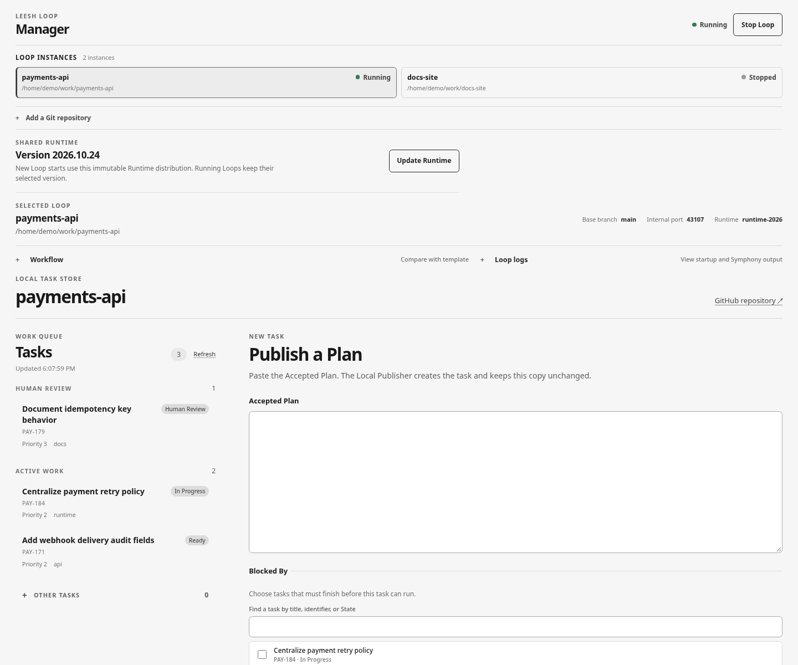
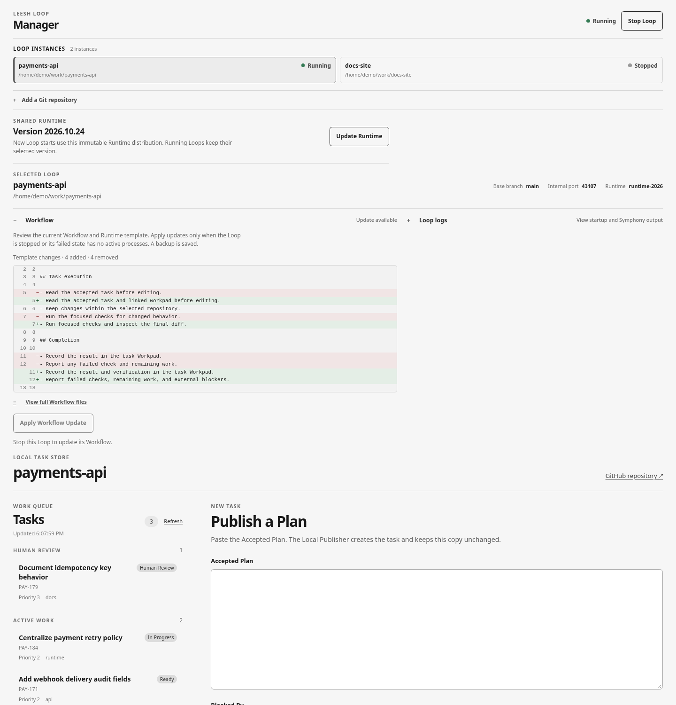
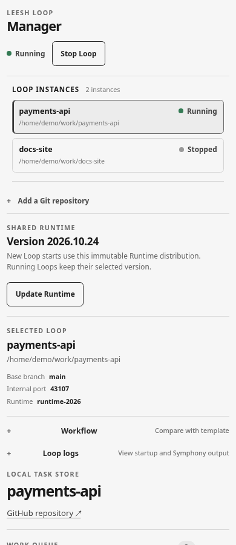

# Operator UI evidence

## Central Manager design evidence

These captures show the production Operator UI bundle rendered from PR #120's UI source at commit `9d8a3b602d98b250f175a5ccaefa1728f9f230a8`. The local fixture in `capture-manager-demo.mjs` supplies synthetic, read-only instance, Runtime, Workflow, and Task responses; no Manager Service, real repository, or Task Store was used. Treat the displayed names, paths, statuses, port, Runtime version, and tasks as illustrative data. These images support visual review only; they do not verify lifecycle behavior or live service integration.

- Desktop overview at 1440×1200: two instance statuses, shared Runtime, selected Loop details, and the task queue.

  

- Desktop Workflow review at 1440×1500: selected instance Workflow diff, visible added and removed lines, and the disabled update control while the synthetic Loop status is Running.

  

- Narrow layout at 390×900: lifecycle action, instance list, Runtime, selected Loop details, and stacked Operator entry point.

  

The desktop and narrow layouts were also opened in Chrome through the browser control during review. The narrow viewport was set explicitly to 390×900 and reset after inspection.

## Current selected-task treatment

The selected-task styling at PR head `5306304bc7821fe0f3fd1fe194c7eafbd3ccf105` is shown in these desktop captures:

- `task-detail-desktop.png` and `task-detail-desktop-reviewed.jpg` show the selected Task with a bold, underlined title, no gray row surface, and no left accent stripe.
- `task-detail-desktop-heading-reviewed.jpg` records the current detail hierarchy alongside the updated selection treatment.
- `task-detail-desktop-keyboard-focus-reviewed.jpg` shows the same selected Task while its row has keyboard focus. Focus adds a dark 2px rule across the row bottom alongside the selected title underline; the row remains transparent and has no left stripe.

The captures were taken from the checkout build against the read-only Local Task Store API at 1521×649. `task-detail-desktop.png` is a PNG conversion of the browser capture so the established evidence path reflects that result.

## Narrow-screen queue follow-up

The narrow-screen queue behavior changed after these captures: at widths up to 960px the task surface follows normal page flow instead of using a 38vh nested scroll area. Selecting a Task or returning to publication now scrolls the destination panel into view and moves focus to its heading; desktop navigation retains its existing page-top behavior. `publication-mobile.png` predates these follow-ups and shows the old nested-scroll behavior; treat it as historical until a fresh narrow-screen capture is available. The connected Chrome control in this run did not expose viewport resizing, so the new narrow layout and destination navigation have not yet been visually captured at phone dimensions.

## Historical captures

`01-task-list-backlog.jpg`, `03-task-detail-plan-workpad-comment.jpg`, `04-human-review-input-state.jpg`, `05-mobile-task-navigation-detail.jpg`, `task-detail-mobile.png`, `publication-mobile.png`, and the older `operator-ui-*` captures are historical layout and content examples. Do not use them to judge the latest narrow-screen queue behavior or the current selected-row treatment at phone dimensions.
