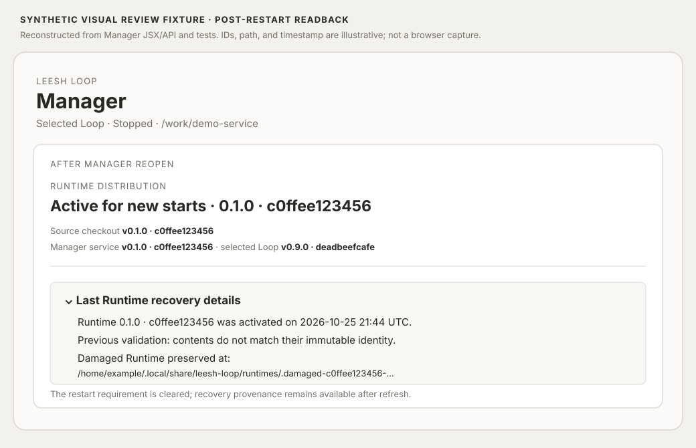

# Runtime recovery readback after Manager restart (synthetic)

This fixture illustrates the state after the Manager has reopened from same-ID repair: the service no longer needs a restart, while a collapsed Runtime recovery disclosure retains the prior validation error and preserved damaged path. The ID, timestamp, and filesystem path are illustrative. It is a source-based visual representation, not a browser capture.

The Manager API test writes and reads the recovery record, clears the restart-required service flag to represent the reopened service record, then confirms that Runtime status still exposes the same prior validation detail and quarantine path. This is test-verified API state persistence; it does not claim a separately spawned OS Manager restart or direct browser observation.
