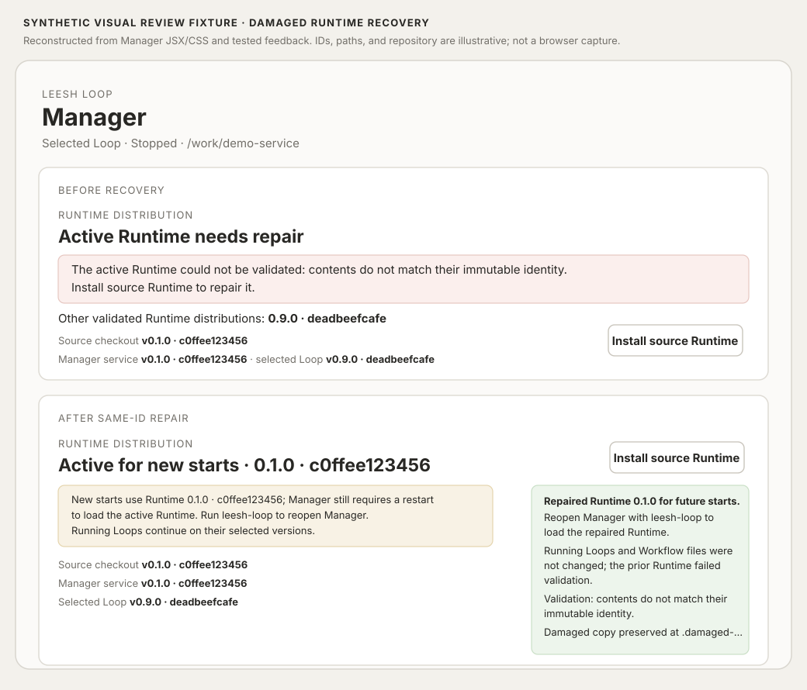

# Damaged Runtime recovery (synthetic)

The persistent post-restart diagnostic state is shown separately in [the Runtime recovery readback fixture](manager-runtime-recovery-readback-synthetic.md).

This fixture represents the Runtime panel before and after repairing a damaged directory under the same immutable Runtime ID. The IDs, repository, and quarantine path are invented. It is a source-based visual reconstruction, not a browser capture or real Runtime observation.

The Manager Runtime API integration test verifies that an invalid active distribution still returns independent status fields and valid alternatives. The repair test verifies the installer preserves damaged bytes and returns the quarantine path. A same-ID Manager update test verifies the persisted restart-required flag, the subsequent Runtime status read, and the restart signal returned by `ensureManagerService`. UI feedback tests verify the recovery message and restart action.

The updated UI state has not been revisited in a browser. The Manager API test runs against a live test server and a same-ID service record, but it does not spawn and observe a real Manager process before and after the same-ID file repair. Earlier isolated CLI recovery was observed and is recorded in [the lifecycle evidence](manager-lifecycle-reassessment.md); that run did not exercise the newly identified live same-ID restart case.
