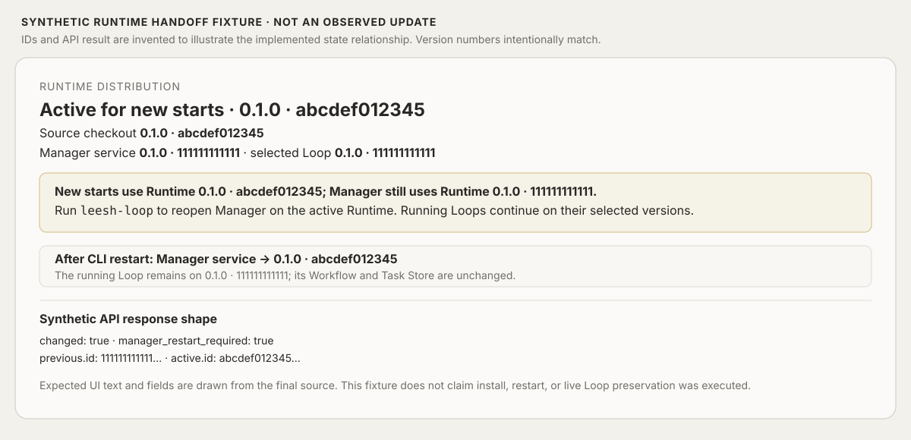

# Runtime handoff scenario (synthetic)

This fixture responds to Reviewability Preparation finding F2 for PR #121. The changed Runtime handoff was not executed in the browser or a live Loop, so every example identity and API response below is explicitly synthetic.



The example uses two immutable distributions with the same package version to show why version text alone is ambiguous:

| Point in flow | Source checkout | Active Runtime for new starts | Manager process | Existing running Loop | Workflow / Task Store |
|---|---|---|---|---|---|
| Before install | `0.1.0 · abcdef012345` | `0.1.0 · 111111111111` | `0.1.0 · 111111111111` | `0.1.0 · 111111111111` | unchanged |
| After install, before Manager restart | `0.1.0 · abcdef012345` | `0.1.0 · abcdef012345` | `0.1.0 · 111111111111` | `0.1.0 · 111111111111` | unchanged |
| After opening Manager through the source CLI | `0.1.0 · abcdef012345` | `0.1.0 · abcdef012345` | `0.1.0 · abcdef012345` | `0.1.0 · 111111111111` | unchanged |

The illustrative Runtime update response is:

```json
{
  "changed": true,
  "manager_runtime_version": "1111111111111111111111111111111111111111111111111111111111111111",
  "manager_restart_required": true,
  "previous": { "id": "1111111111111111111111111111111111111111111111111111111111111111", "version": "0.1.0" },
  "active": { "id": "abcdef0123456789abcdef0123456789abcdef0123456789abcdef0123456789", "version": "0.1.0" }
}
```

The displayed warning and completion wording are taken from `operator/ui/src/main.jsx`; IDs are formatted by `operator/ui/src/runtime-label.js`. Source behavior is code-observed. The response and state sequence are synthetic and do not establish that a changed Runtime was installed, that an existing Loop was live, or that the post-restart observations occurred. The real no-change update path and the independent source CLI recovery path have separate observations in [the lifecycle evidence record](manager-lifecycle-reassessment.md).
